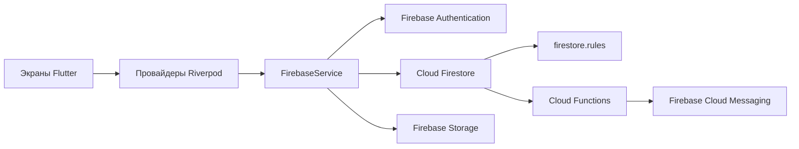

<div align="center">


# Issiqlik Ta'minoti

**Цифровое рабочее пространство для котельных и централизованного отопления Хорезмской области.**

[Русский](README.md) · [O'zbekcha](README_UZ.md) · [English](README_EN.md)

[](https://flutter.dev/)
[](https://firebase.google.com/)
[](LICENSE)
[](https://github.com/SenixDev0220/issiqlik-taminoti/actions/workflows/flutter.yml)

*Открытый исходный код приложения для сотрудников предприятия «Хоразм Иссиқлик Манбаи».*

</div>

## Версия 1.2: Spark и безопасность

Эта ветка основана на актуальном локальном интерфейсе и новой Android-иконке. Регистрация и основные текстовые операции работают через Firebase Auth + проверяемые Firestore Rules, без обязательного Blaze/Cloud Functions. Новая регистрация всегда `member/pending`; первый администратор создаётся только доверенным оператором. **Перед использованием необходима проверенная миграция существующей базы и публикация новых правил/индексов. В этой работе production deployment не выполнялся.**

Уведомления доступны внутри приложения; фоновые push, загрузка файлов и административный сброс пароля из приложения не поддерживаются в этом варианте Spark. Конфиденциальные схемы не включаются в APK. Подробности, ограничения и порядок rollout: [security/README.md](security/README.md).

## О проекте

**Issiqlik Ta'minoti** помогает сотрудникам предприятия, обслуживающего котельные и систему отопления Хорезмской области, вести ежедневную работу в одном приложении. Интерфейс локализован на узбекский язык в кириллице и латинице. Основная целевая платформа — Android.

## Возможности

| Область | Возможности |
| --- | --- |
| Котельные | Паспортные сведения, статусы, фильтрация по району, поиск и схемы объектов |
| Оборудование | Просмотр оборудования котельных и его характеристик |
| Оперативная работа | Журнал событий, записи смен и оперативные заметки |
| Рабочие материалы | Инструкции и схемы котельных |
| Уведомления | Рабочие и системные уведомления, push-доставка через Firebase Cloud Messaging |
| Сотрудники | Профили, роли, статусы пользователей и административное утверждение новых учётных записей |
| Аналитика | Сводные показатели котельных, потребление по районам и распределение статусов |
| Офлайн-доступ | Кэш Firestore и отложенная синхронизация текстовых изменений после восстановления соединения |

### Роли и доступ

- **Администратор** управляет пользователями, ролями, данными и настройками.
- **Соадминистратор** помогает управлять рабочими данными и сотрудниками.
- **Сотрудник** пользуется доступными рабочими разделами после подтверждения учётной записи.
- Все новые учётные записи получают `member/pending`; администратора назначает доверенный оператор после проверки UID.

Офлайн-кэш относится к данным Firestore. Авторизация, действия, требующие Firebase Auth или Cloud Functions, а также загрузка фотографий в Firebase Storage требуют соединения. Фото и другие файлы не входят в очередь офлайн-синхронизации.

## Технологии и устройство приложения

- **Flutter / Dart** — мобильный интерфейс и Android-сборка.
- **Android 7.0+ (API 24+)** — минимальная версия Android для APK.
- **Firebase Authentication** — вход по логину и управление учётными записями.
- **Cloud Firestore** — рабочие данные, потоковые обновления и офлайн-кэш.
- **Firebase Storage** — фотографии и пользовательские файлы.
- **Firebase Cloud Messaging** и **Cloud Functions** — push-уведомления и выполнение административного сброса пароля.
- **Riverpod** — состояние; **GoRouter** — маршрутизация.

Путь данных централизован: экраны функций читают Riverpod-провайдеры, действия передаются через провайдеры в единый [FirebaseService](lib/src/services/firebase_service.dart), а Firestore-документы преобразуются в модели из каталога [lib/src/domain/models](lib/src/domain/models). Общие провайдеры и состояние находятся в [app_state.dart](lib/src/core/app_state.dart); маршруты приложения — в [app.dart](lib/app.dart).

Firestore-контракт и разделение прав определяются файлом [firestore.rules](firestore.rules), в котором остальные пути закрыты правилом по умолчанию. Клиентская синхронизация записей и её состояние централизованы в [firestore_sync_tracker.dart](lib/src/core/firestore_sync_tracker.dart).



Стеклянная нижняя панель не размывает весь движущийся фон на каждом кадре. Её индикатор использует упругую анимацию сдвига и `RepaintBoundary`, а при переходах экранов нет дорогого полноэкранного затухания.

## Быстрый старт

### Требования

- Flutter SDK, удовлетворяющий ограничению Dart SDK из [pubspec.yaml](pubspec.yaml).
- Android SDK и JDK 17 для сборки Android-приложения.
- Настроенный Firebase-проект для входа и работы с серверными данными.

### Запуск

```bash
flutter pub get
flutter run
```

### Проверки и сборка

```bash
flutter analyze
flutter test
flutter test test/firestore_sync_tracker_test.dart
flutter build apk --release
```

Для Android укажи локальные пути к Flutter и Android SDK в `android/local.properties`. Этот файл, каталоги сборки, APK и локальные настройки IDE исключены из Git.

Release APK в проекте по умолчанию подписывается **debug-ключом** и предназначен для установки и тестирования. Перед публикацией в Google Play настрой отдельную release-подпись в `android/app/build.gradle.kts`; не добавляй keystore и пароли подписи в репозиторий.

## Firebase и настройка форка

Исходная конфигурация Firebase находится в `lib/firebase_options.dart` и `android/app/google-services.json` и относится к проекту владельца приложения. Для собственного развёртывания зарегистрируй свои Firebase-приложения и замени клиентскую конфигурацию на конфигурацию своего Firebase-проекта. Данные котельных в seed-файлах также являются данными этого проекта; проверь их и при необходимости замени своими.

После настройки Firebase:

1. Создай проект Firebase и включи необходимые продукты Authentication, Firestore, Storage и Cloud Messaging.
2. Настрой локальную клиентскую конфигурацию Firebase.
3. Настрой `firebase.json` и локальный `.firebaserc` на **свой** Firebase-проект; не развёртывай службы форка в проект владельца исходного приложения.
4. Разверни правила Firestore из `firestore.rules`.
5. Установи зависимости функций Node.js 20 из каталога `functions/`, если нужны push-уведомления и административный сброс пароля.
6. Разверни Cloud Functions и проверь их работу с собственной Firebase-конфигурацией. Для функций может потребоваться тариф Firebase Blaze.

Firebase client API key в мобильном приложении является идентификатором клиентской конфигурации, а не административным секретом. Не добавляй в репозиторий service-account JSON, приватные ключи, пароли, keystore или секреты подписи.

## Тестирование

В [test](test) находятся проверки локализации, компонентов, моделей, навигационной анимации и состояний Firestore-синхронизации. [GitHub Actions](.github/workflows/flutter.yml) запускает анализ, тесты и release-сборку APK при push и pull request. APK доступен как артефакт workflow 14 дней.

## Участие в разработке

Перед отправкой изменений запусти `flutter analyze`, `flutter test` и, для Android-изменений, `flutter build apk --release`. Для изменений Firestore проверь соответствующие правила безопасности; при добавлении коллекции без подходящего блока запросы будут запрещены. Пользовательский текст интерфейса должен иметь варианты и для узбекской кириллицы, и для латиницы. Подробнее: [CONTRIBUTING.md](.github/CONTRIBUTING.md), [шаблон pull request](.github/PULL_REQUEST_TEMPLATE.md), [инструкции Copilot](.github/copilot-instructions.md).

Об уязвимости безопасности сообщай приватно через [GitHub Security Advisories](https://github.com/SenixDev0220/issiqlik-taminoti/security/advisories/new); не публикуй реальные учётные данные и персональные данные в issues.

## Лицензия

Исходный код распространяется по лицензии MIT. Перед повторным использованием фотографий, схем и других материалов проверь права на соответствующие ресурсы: лицензия кода не заменяет разрешения третьих лиц на их материалы.
