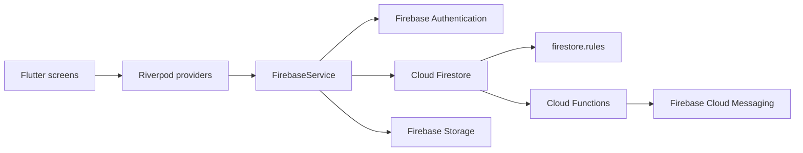

# Issiqlik Ta'minoti

[Русский](README.md) · [O'zbekcha](README_UZ.md) · [English](README_EN.md)

An open-source Flutter workspace for boiler-house operations and district heating in Khorezm, Uzbekistan. Built for the employees of Khorazm Issiklik Manbai, with a mobile interface in Uzbek Cyrillic and Latin.

## What the app does

| Area | Capabilities |
| --- | --- |
| Boiler houses | Passport details, operational status, district filters, search, and facility schemas |
| Equipment | Browse equipment and related boiler-house data |
| Shift work | Event journal, shift records, and operational notes |
| Reference material | Operating instructions and boiler-house drawings |
| Notifications | In-app alerts and Firebase Cloud Messaging push notifications |
| Staff | User profiles, roles, account status, and administrator approval |
| Analytics | Fleet summaries, district-level consumption, and status breakdowns |
| Offline | Firestore cache and automatic synchronization of queued text writes |

The first account registered in an empty Firebase database becomes an active administrator. Later accounts require approval. Firestore text writes can queue offline; authentication, Cloud Functions, and Firebase Storage uploads still require a network connection.

## Technology and architecture

- Flutter and Dart for the app; Android 7.0 (API 24) is the minimum Android version.
- Firebase Authentication, Cloud Firestore, Cloud Storage, and Firebase Cloud Messaging.
- Riverpod for application state; GoRouter for navigation.
- Firebase Cloud Functions for push delivery and administrator-initiated password resets.



`FirebaseService` centralizes Firebase access and Firestore document mapping. Domain models live in `lib/src/domain/models/`; shared providers are in `lib/src/core/app_state.dart`; feature screens and providers are in `lib/src/features/`; routes are registered in `lib/app.dart`. Firestore rules are default-deny in `firestore.rules`.

## Get started

### Requirements

- Flutter and Dart versions compatible with `pubspec.yaml`.
- Android SDK and JDK 17 for Android builds.
- Your own configured Firebase project for authenticated app features.

```bash
flutter pub get
flutter run
```

### Analyze, test, and build

```bash
flutter analyze
flutter test
flutter test test/firestore_sync_tracker_test.dart
flutter build apk --release
```

Set local Android and Flutter SDK paths in `android/local.properties`; it is intentionally excluded from Git. The generated release APK uses the debug signing configuration by default and is for testing, not Play Store distribution. Configure a private release keystore before publishing.

## Firebase setup for forks

The checked-in Firebase client configuration targets the project used by the original app. To use this code with your own backend:

1. Create your Firebase project and register its Android app.
2. Replace the local Firebase client configuration with files generated for your project.
3. Update `firebase.json` and `.firebaserc` to point to **your** project before deploying anything. Do not deploy to the original project's Firebase services.
4. Configure Authentication, Firestore, Storage, and Cloud Messaging; then deploy `firestore.rules`.
5. For push delivery and administrator-initiated password resets, install Node.js 20 function dependencies under `functions/` and deploy the Cloud Functions. Cloud Functions may require the Firebase Blaze plan.
6. Review boiler-house passport data and sample data in `lib/src/data/` before using the app in a different operation.

Firebase client API keys identify a client configuration; they are not service-account credentials. Never commit a service-account JSON file, private key, account password, Android keystore, or signing password. The project includes real-world boiler-house data and third-party assets; verify that you have the necessary rights before redistributing those materials.

## GitHub project

- [Contribution guide](.github/CONTRIBUTING.md)
- [Copilot instructions](.github/copilot-instructions.md)
- [Report a bug](https://github.com/SenixDev0220/issiqlik-taminoti/issues/new?template=bug_report.yml)
- [Suggest a feature](https://github.com/SenixDev0220/issiqlik-taminoti/issues/new?template=feature_request.yml)
- [Flutter CI workflow](.github/workflows/flutter.yml) — analysis, tests, and Android release build; the APK is retained as a CI artifact for 14 days.

Please do not post credentials, personal data, or non-public operational details in issues. Report suspected security vulnerabilities privately through [GitHub Security Advisories](https://github.com/SenixDev0220/issiqlik-taminoti/security/advisories/new).

## License

The source code is licensed under the [MIT License](LICENSE). The license does not grant rights to third-party photographs, diagrams, or other bundled materials.
