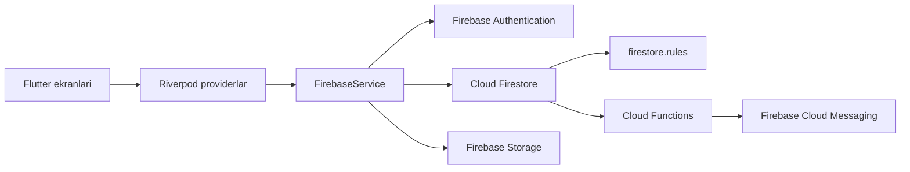

# Issiqlik Ta'minoti

[Русский](README.md) · [O'zbekcha](README_UZ.md) · [English](README_EN.md)

Xorazm viloyatidagi qozonxonalar va markazlashgan issiqlik ta'minotini boshqarishga mo'ljallangan ochiq kodli Flutter ilovasi. Ilova “Xorazm Issiqlik Manbai” korxonasi xodimlari uchun yaratilgan; interfeys o'zbek kirill va lotin yozuvlarini qo'llab-quvvatlaydi.

## Ilova imkoniyatlari

| Yo'nalish | Imkoniyatlar |
| --- | --- |
| Qozonxonalar | Pasport ma'lumotlari, ish holati, tuman bo'yicha saralash, qidirish va sxemalar |
| Uskunalar | Qozonxonalarga tegishli uskunalar va ularning ma'lumotlari |
| Smena ishlari | Hodisalar jurnali, smena yozuvlari va tezkor qaydlar |
| Ish hujjatlari | Foydalanish yo'riqnomalari va qozonxona chizmalari |
| Bildirishnomalar | Ilova xabarlari va Firebase Cloud Messaging push-bildirishnomalari |
| Xodimlar | Foydalanuvchilar, rollar, hisob holatlari va administrator tasdig'i |
| Tahlil | Qozonxonalar bo'yicha umumiy ko'rsatkichlar va hududlar kesimidagi sarf |
| Oflayn ish | Firestore keshi va matnli yozuvlarning tarmoq qaytganda sinxronlanishi |

Bo'sh Firebase bazasida ro'yxatdan o'tgan birinchi foydalanuvchi faol administrator bo'ladi. Keyingi foydalanuvchilar administrator tasdig'ini kutadi. Firestore matnli yozuvlarni oflayn navbatga qo'yishi mumkin; autentifikatsiya, Cloud Functions va Firebase Storage'ga fayl yuklash tarmoqni talab qiladi.

## Texnologiyalar va arxitektura

- Flutter va Dart; Android 7.0 (API 24) — minimal versiya.
- Firebase Authentication, Cloud Firestore, Cloud Storage va Firebase Cloud Messaging.
- Holatni boshqarish uchun Riverpod; navigatsiya uchun GoRouter.
- Push-bildirishnomalar va administrator tomonidan parolni yangilash uchun Firebase Cloud Functions.



Firebase xizmatlariga murojaat va Firestore hujjatlarini modellar bilan bog'lash `lib/src/services/firebase_service.dart` ichida markazlashtirilgan. Modellar `lib/src/domain/models/`, umumiy providerlar `lib/src/core/app_state.dart`, ekranlar `lib/src/features/`, marshrutlar esa `lib/app.dart` ichida. `firestore.rules` da alohida ruxsat berilmagan yo'llar yopiq.

## Ishga tushirish

### Kerakli vositalar

- `pubspec.yaml` dagi Dart SDK talabiga mos Flutter SDK.
- Android APK yig'ish uchun Android SDK va JDK 17.
- Ilovaning Firebase funksiyalari uchun o'zingiz sozlagan Firebase loyihasi.

```bash
flutter pub get
flutter run
```

### Tekshiruv va APK yig'ish

```bash
flutter analyze
flutter test
flutter test test/firestore_sync_tracker_test.dart
flutter build apk --release
```

Android va Flutter SDK manzillarini lokal `android/local.properties` faylida ko'rsating; bu fayl GitHub'ga yuborilmaydi. Hozirgi release APK konfiguratsiyasi sinov uchun debug kalit bilan imzolanadi. Google Play uchun maxfiy release keystore sozlash kerak.

## Firebase'ni sozlash

Repozitoriydagi Firebase klient konfiguratsiyasi dastlabki ilova loyihasiga tegishli. O'z loyihangiz uchun:

1. Firebase loyihasini yarating va Android ilovasini ro'yxatdan o'tkazing.
2. Firebase klient konfiguratsiyasini o'zingiznikiga almashtiring.
3. Xizmatlarni joylashtirishdan oldin `firebase.json` va `.firebaserc` ni **o'z** Firebase loyihangizga moslang. Dastlabki ilova egasining Firebase xizmatlariga deploy qilmang.
4. Authentication, Firestore, Storage va Cloud Messaging'ni sozlang hamda `firestore.rules` qoidalarini joylashtiring.
5. Push-bildirishnomalar va administrator parolni yangilashi kerak bo'lsa, `functions/` ichida Node.js 20 bog'liqliklarini o'rnating va Cloud Functions'ni deploy qiling. Buning uchun Firebase Blaze tarif rejasi kerak bo'lishi mumkin.
6. Boshqa muassasada ishlatishdan oldin `lib/src/data/` ichidagi qozonxona ma'lumotlari va namuna ma'lumotlarini tekshiring.

Firebase klient API kaliti xizmat hisobining maxfiy kaliti emas. Service-account JSON, yopiq kalit, parol, Android keystore yoki imzolash parolini repozitoriyga yubormang. Haqiqiy qozonxona ma'lumotlari va uchinchi tomon materiallarini qayta tarqatishdan oldin ulardan foydalanish huquqini tekshiring.

## Loyiha havolalari

- [Hissa qo'shish qoidalari](.github/CONTRIBUTING.md)
- [Copilot ko'rsatmalari](.github/copilot-instructions.md)
- [Xatolik haqida xabar berish](https://github.com/SenixDev0220/issiqlik-taminoti/issues/new?template=bug_report.yml)
- [Yangi imkoniyat taklif qilish](https://github.com/SenixDev0220/issiqlik-taminoti/issues/new?template=feature_request.yml)
- [Flutter CI](.github/workflows/flutter.yml) — tahlil, testlar va Android APK yig'ish; artifact 14 kun saqlanadi.

Issue'larda parol, shaxsiy ma'lumot yoki ommaga ochiq bo'lmagan korxona ma'lumotlarini joylashtirmang. Xavfsizlikka oid muammolarni [GitHub Security Advisories](https://github.com/SenixDev0220/issiqlik-taminoti/security/advisories/new) orqali maxfiy tarzda yuboring.

## Litsenziya

Manba kodi [MIT litsenziyasi](LICENSE) ostida tarqatiladi. Ushbu litsenziya uchinchi tomon suratlari, chizmalari yoki boshqa materiallariga alohida foydalanish huquqini bermaydi.
